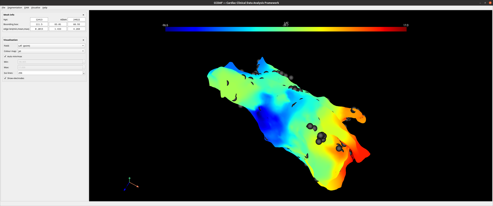

# EAM & visualisation

## Loading an EAM mapping

**EAM → Load** reads a Carto mapping (`<map_name>.mesh` + electrodes) and adopts
its surface as the working mesh. The surface arrives with its point-data fields
(bipolar/unipolar voltage, LAT, …) and a set of **electrode** positions drawn as
spheres.

CCDAF's guarantee: whenever the surface later moves — smoothing, clipping, a
segmentation round trip — the electrodes are re-warped to keep their
distance-to-wall, on the same side. The method is in
[Concepts → Electrode displacement](../concepts.md#electrode-displacement).

### Electrograms

Tick **Load electrograms** in the EAM file dialog to also read the
electrograms (EGMs) of the map. It is off by default: it takes a few seconds
to tens of seconds (about 14 s for a 1500-point PentaRay map, 27 s for a
6700-point OctaRay map) and adds 20–75 MB to a saved bundle.

Once the map is chosen, an **Electrograms** dialog shows:

- **Mapping catheter** — the connector whose electrode positions are stored,
  set to the one CCDAF detected from where the points sit. Change it only if the
  detection is wrong.
- **Always stored** — the reference channel, every bipole that a point of the
  map uses (for a PentaRay: 1-2 and 3-4 of each spline), and the unipoles of
  those bipoles.
- **Extra channels** — every other channel in the map's ECG files (surface ECG,
  CS, …), unticked. A ticked channel is stored as a trace only, with no
  position.

**Load** reads them; **Cancel** keeps the map without electrograms.

What is stored, per catheter placement (one placement = one ECG file, the
catheter at one location):

- the traces, as raw integer counts plus the gain to convert them to mV;
- the reference annotation: the sample where the reference channel activates,
  which is time 0. A point's activation is at its LAT on that axis;
- the position of every mapping-catheter electrode, so non-point electrodes
  have a position too.

Notes the import may report:

- **Missing splines.** Some Carto position files lack whole splines. When the
  points of that placement show which spline is missing, the others keep their
  positions; otherwise their positions are left empty. Traces are always kept.
- **Points from another catheter.** A point recorded with another catheter
  (for example the ablation catheter) keeps its electrode, but no electrogram
  is stored for it.

The electrograms are kept in a **File → Save data** bundle and reloaded with
it. When the surface moves, the catheter electrodes move with the other
electrodes, by the same rule. See [File formats](../file-formats.md#electrograms).

## Exporting

**EAM → Export** writes either:

- **Binary** — a pickled `{'surface', 'electrodes'}` bundle, as the reference
  Carto pipeline consumes (plus the electrograms under `egm`, when loaded); or
- **VTK** — the surface with every field, for ParaView (electrodes are separate
  geometry and are not embedded).

The dialog also offers an **ASCII** VTK option (text rather than binary; VTK
only — a pickle has no text form). See [File formats](../file-formats.md).

## Visualisation panel

<figure markdown="span">
  
  <figcaption>A mapping rendered by field, with electrode positions shown.</figcaption>
</figure>

Controls how the mesh is coloured:

- **Field** — which point-data field to project onto the surface.
- **Colour map** — the colour map used to render it.
- **Auto min/max** — take the colour range from the field's own data range; when
  off, set **Min** / **Max** by hand.
- **Iso lines** — number of discrete colour bands.
- **Show electrodes** — draw the mapping's electrode positions (greyed until a
  mapping with electrodes is loaded).
- **Show fibres**, **Direction**, **Segments**: draw a volume's `fiber` or
  `sheet` directions as line segments over a see-through surface (greyed until
  the volume carries `fiber`). See [Fibres](fibres.md#showing-the-fibres).

The **Visualise** menu and the **Display** options control which overlays
(points, projected points, slices) are shown.
