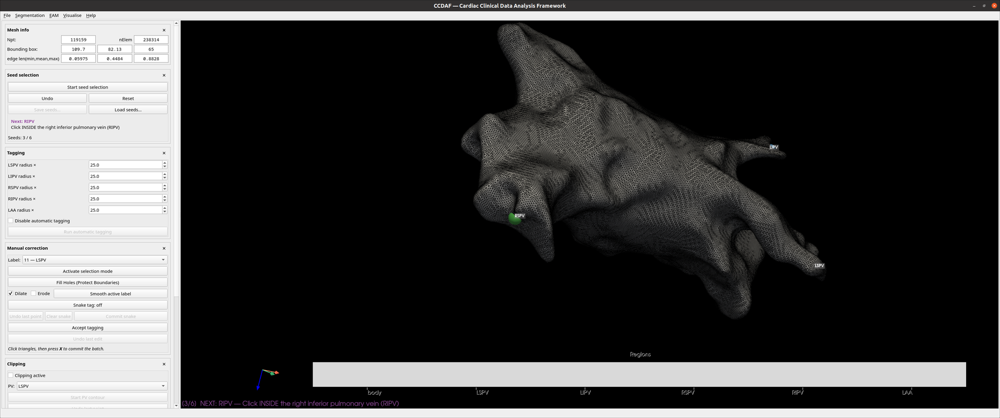
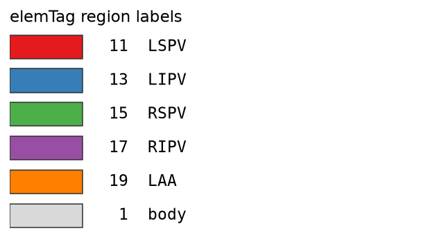
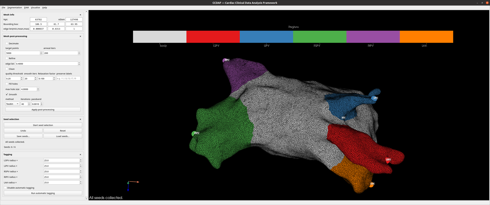

# Seeds & tagging

## Seed selection

The **Seed type** dropdown at the top of the panel chooses which set of
surface points you are placing — and, with it, what the rest of the workflow
offers:

- **seed_LA** (default) — the left atrium: the six anatomical landmarks below
  that drive region tagging. Exported under the `seed_LA` key.
- **seed_RA** — the right atrium: five seeds (see
  [Right atrium](#right-atrium)), the same tagging, correction and clipping
  with the right-atrial labels. Exported under the `seed_RA` key.

The sets are independent: you can complete both in one session — switching
the dropdown keeps each set's picks — and a saved bundle carries every
completed set at once. The rest of this section describes the default
**seed_LA** set; the right atrium works the same way.

!!! note "`landmarks_LA_UAC` removed"

    An earlier version offered a `landmarks_LA_UAC` set of four left-atrial
    landmarks. The atrial coordinates are computed without them, so the set is
    gone. A file that still carries it loads; that set is ignored.

!!! note "Renamed from `seed`"

    The six-seed set was called **seed** and written under the `seeds` key.
    New files use `seed_LA`. Files carrying the old key still load, and the
    status bar says so; the next save writes the new spelling.

### One dropdown drives four panels

**Seed type** is the workflow's one anatomy switch. Tagging, Manual correction
and Clipping have no dropdown of their own: each follows this one and offers
only what that seed type defines, so the left atrium's veins never appear on a
mesh that has none. Each of the three names the type it is following, and says
so when there is nothing to offer.

| Seed type | Pick points | Tagging | Manual correction | Clipping |
|---|---|---|---|---|
| `seed_LA` | 6 seeds | LSPV, LIPV, RSPV, RIPV, LAA radii | LA body, LSPV, LIPV, RSPV, RIPV, LAA | LSPV, LIPV, RSPV, RIPV, MV |
| `seed_RA` | 5 seeds | SVC, IVC, CS, RAA radii | RA body, SVC, IVC, CS, RAA | SVC, IVC, CS, TV |

The tools act on the atrium of the chosen seed type: switch to `seed_LA` to
correct or clip a left atrium, to `seed_RA` for a right one. Values you tuned
(a radius factor, the active label, the clip region) are remembered for each
seed type across the switch.

**Run automatic tagging** acts on the chosen seed type and no other, so
changing the dropdown never re-runs another set's tagging behind your back.

Tagging needs six anatomical landmarks, placed **in order**:

| # | Seed | Meaning |
|---|---|---|
| 1 | LSPV | Left superior pulmonary vein |
| 2 | LIPV | Left inferior pulmonary vein |
| 3 | RSPV | Right superior pulmonary vein |
| 4 | RIPV | Right inferior pulmonary vein |
| 5 | LAA  | Left atrial appendage |
| 6 | MV   | Mitral valve (centre) |

**Start seed selection**, then click each landmark on the surface. The heads-up
prompt shows which seed is next. Each pick:

1. snaps to the nearest **visible** surface vertex (hardware picking — no
   bleed-through to the far wall);
2. is rejected if it is too close to an existing seed;
3. for the PV seeds, is checked against an anatomical prior (the pick must sit
   on a protrusion — see [Concepts](../concepts.md#seed-geometry)).

Controls:

- **Undo** removes the last seed so you can re-pick it.
- **Reset** clears all seeds — the way to start the set over.
- **Start seed selection** normally begins a fresh set. The exception is when
  another tool interrupted this one (see
  [Troubleshooting](../troubleshooting.md#a-tool-switched-itself-off-when-i-started-another-one)):
  then it resumes where it stopped, keeping the seeds already placed.
- **Save seeds… / Load seeds…** — seeds are stored as names + coordinates (no
  vertex ids), so they reload onto a clipped or refined mesh, each snapped to
  the current surface by nearest point.

<figure markdown="span">
  
  <figcaption>Seed placement — markers on the surface with the next-seed prompt.</figcaption>
</figure>

## Automatic tagging

Once the seeds are in, the **Tagging** panel grows each region as a **geodesic
region** from its seed and writes the labels into `elemTag`.

- **Radius factors** — a per-region cap on how far each region grows, expressed
  as *factor × median edge length*. Each vein has its own factor and the LAA has
  a larger default (it is a lobed pouch that expands more than the vein tubes).
- **Disable automatic tagging** — a guard that greys out the run button to
  prevent accidental re-runs.
- **Run automatic tagging** — performs the tagging.

The regions and their labels:

{ width="320" }

<figure markdown="span">
  
  <figcaption>The tagged atrium — each region in its label colour.</figcaption>
</figure>

After tagging, refine the result in [Manual correction](manual-correction.md).

## Right atrium

Choose **seed_RA** and place five seeds, **in order**:

| # | Seed | Meaning |
|---|---|---|
| 1 | SVC | Superior vena cava (inside it) |
| 2 | IVC | Inferior vena cava (inside it) |
| 3 | CS  | Coronary sinus (inside it) |
| 4 | RAA | Right atrial appendage (inside it) |
| 5 | TV  | Tricuspid valve (centre); used for clipping, not tagged |

Tagging writes these labels to `elemTag`:

**Right-atrial labels**

| Region | `elemTag` |
|---|---:|
| RA body | 2 |
| SVC | 21 |
| IVC | 23 |
| CS | 25 |
| RAA | 27 |

The right-atrial body is 2, not the left atrium's 1, so a mesh that holds both
atria keeps them apart. The legend and its colours follow the labels present:
a left atrium, a right atrium, or both.

The radius factors start at 50 for the venae cavae and the appendage, which
are wider than the pulmonary veins, and at 25 for the narrower coronary sinus.
On the 16 labelled right atria of the published fibre atlas, these starting
values gave regions that overlap the published ones by a Dice coefficient of
about 0.6 to 0.9. Tune them before running, as for the left atrium.
