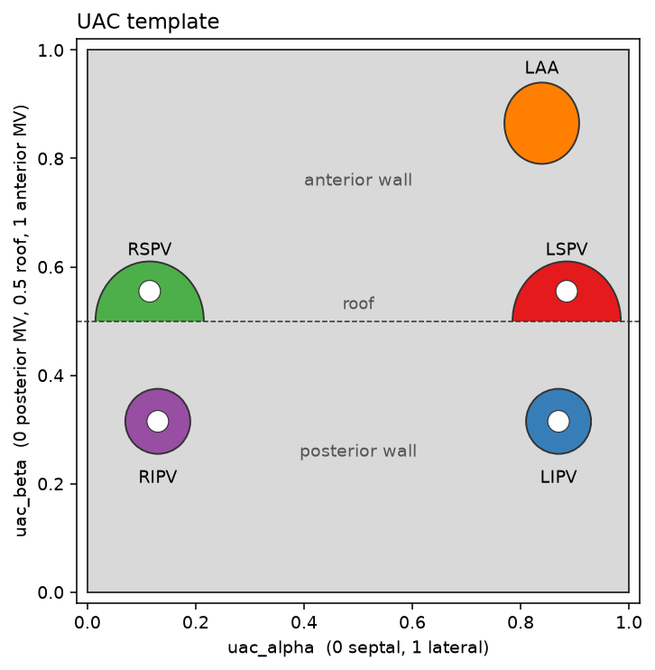

# Universal atrial coordinates

**Actions → Compute UAC…**

Gives every point of a labelled left-atrial surface two coordinates on a fixed
unit square, so the same place in different atria has the same coordinates.
The veins and the appendage land in the same place for every patient. The
coordinates are written as point arrays and can be shown like any other field.

**The two coordinates and their ranges**

| Array | Coordinate | Range |
|---|---|---|
| `uac_alpha` | septal to lateral | 0 on the septal side (right veins) to 1 on the lateral side (left veins) |
| `uac_beta` | posterior to anterior, over the roof | 0 at the posterior mitral valve, 0.5 on the roof, 1 at the anterior mitral valve |

The posterior wall is the lower half of the square (`uac_beta` below 0.5), the
anterior wall the upper half.

<figure markdown="span">
  
  <figcaption>The template square. The inferior veins are circles on the
  posterior half; the superior veins are half-ellipses standing on the roof
  line; the appendage is an ellipse on the anterior half. The small circles are
  the veins' open ends.</figcaption>
</figure>

## What it needs

The item is enabled on a **triangle surface** whose `elemTag` has all six left
atrial labels:

| Label | Region |
|---:|---|
| 1 | body |
| 11 | LSPV |
| 13 | LIPV |
| 15 | RSPV |
| 17 | RIPV |
| 19 | LAA |

These are the labels [Seeds & tagging](seeds-tagging.md) writes. The surface
must be open at the mitral valve and at the end of each vein (see
[Clipping](clipping.md)). The appendage stays closed. No landmarks are needed.
Lengths are taken to be in millimetres.

Otherwise the item is greyed out, and its tooltip says what is missing.

## The window

There is nothing to choose. **Compute** runs in the background (a few minutes
on a typical atrium) and reports progress; **Stop** stops it and changes
nothing. When the run finishes, the surface is replaced by its repaired copy
(see [Repairs to the surface](#repairs-to-the-surface)), with `uac_alpha` and
`uac_beta` added and shown. Every other field comes along. **Undo** puts back
the surface as it was before Compute.

**Save flat map…** saves the square itself as a mesh (see
[The flat map](#the-flat-map)). It works on any surface that has `uac_alpha`
and `uac_beta`, also one loaded from a file, with no need to compute again.
**File → Save** ticks the two arrays by default.

If the surface already has `uac_alpha` and `uac_beta` (from an earlier run or
from the file), the window says so: **Compute** replaces them, computed from
the labels as they are now. Use this to recompute after changing the tagging.
The replaced values stay in the file on disk until you save.

The window is not modal, so you can keep working in the view. If the surface or
its labels change while a run is in progress, the result is discarded.

**The report** gives:

- the solver used (see [Speed](#speed));
- how the atrium was cut open;
- for each half, the number of folded triangles (0 is the normal result) and
  how far each ring ended from its place on the template (in units of the
  square; below 0.01 is a close fit);
- any patch the map collapsed to a point (see [When it fails](#when-it-fails));
- what the repair changed on the surface, and any vein extensions added;
- warnings, if the fit is poor.

## How it works

The method follows Roney et al. (*Med Image Anal* 2019), with changes that make
it fully automatic and keep the map free of folds.

1. **Repair** the surface (see below). The repairs are kept.
2. **Vein extensions.** Each vein fills a ring between its ostium and its open
   end on the template. Clipped veins are usually shorter than that ring
   needs, and a short vein would be crushed. Each vein is lengthened with a
   virtual extension for the computation only; it is never written to the
   surface and gets no coordinates.
3. **Cut.** The atrium is opened along a line from the mitral valve up the
   lateral wall, round the posterior half of the LSPV ostium, over the roof,
   round the posterior half of the RSPV ostium and down the septal wall back to
   the valve. Both inferior veins must end on the posterior half; both
   superior veins and the appendage on the anterior half.
4. **Flat map.** Each half is laid on its half of the square with a map that
   cannot fold, then warped so every ring reaches its template place, again
   without folding a triangle.

**Points on the cut** belong to both halves and so have two values. The point
arrays carry the posterior value. The anterior value follows from it: on the
lateral and septal lines it is (`uac_alpha`, 1 − `uac_beta`), and on the roof
the two are the same. The flat map has both.

### Repairs to the surface

A flat map cannot be made of every surface a segmentation or a clip leaves.
Compute repairs these, in this order, and keeps the result as your surface.
No point moves.

**What Compute repairs, and which other step does the same**

| Repair | What it fixes | Also done by |
|---|---|---|
| Label islands | A small patch of one label inside another joins the label round it, so each label is one patch | Tagging (on accept and on load) |
| Duplicate triangles | A zero-area flap listed twice goes; the wall keeps its triangle | [Clean](post-processing.md#clean) |
| Winding | Triangle orientation made consistent | Clean |
| Ears and slivers on openings | A triangle with two sides on an opening, or a very flat one along it, is removed with any point it leaves unused | [Apply clip](clipping.md) |
| Edge flips | A long thin pair of triangles is re-cut along its other diagonal | Clean (tick box), [Flip edges](post-processing.md#flip-edges) |
| Pinched points | A point the rim passes through twice gets one copy per side | Clean, Apply clip |
| Thin tunnels | A bridge of tissue is cut along its shortest loop, under 15 mm, and both cut ends are closed with a patch that takes the label round it | Clean |

A surface already repaired by those steps needs nothing more, so Compute leaves
it as it is and the report says "no repair needed". A tunnel whose shortest
loop is longer than 15 mm is not a thin bridge: it is not cut, and the run stops
and asks you to fix the segmentation.

A copied point (pinch or tunnel cut) keeps its fields; a tunnel patch's centre
point gets the mean of its neighbours. That value is filled in, not measured.

## The flat map

**Save flat map…** writes the square as a VTK surface in the plane z = 0:

- the points' x and y are `uac_alpha` and `uac_beta`;
- points on the cut appear once for each half;
- it is drawn from the stored `uac_alpha` and `uac_beta`, so it is the same
  map whether you save it right after Compute or after loading the atrium
  from a file;
- point array `uac_source` is the index of the atrium's point each flat point
  comes from, so any field of the atrium can be carried to the square;
- every other point field and every cell field of the atrium (`elemTag`
  included) is carried across;
- vein extensions are left out (they are never part of the surface).

## When it fails

**Messages that stop a run, and what to do**

| Message | Meaning | What to do |
|---|---|---|
| Labels missing | One of the six labels is absent | Tag the atrium |
| No mitral valve opening | No opening borders body tissue | Clip the mitral valve |
| The surface has N tunnel(s) … longer than 15 mm | A wide tunnel, not a thin bridge | Fix the segmentation |
| No valid cut. The left and right vein labels touch … | No body tissue between the left and right veins for the roof | Shrink the vein labels |
| No valid cut. … The vein layout may be twisted, or vein labels swapped | No cut can put both inferior veins on the posterior half | Check which vein is which |

A run can also finish with a **warning** that a ring is far from its template
place. The coordinates are still fold-free, but they are less precise around
that ring. The usual cause is a vein label that runs well onto the body; the
warning names any ostium longer than 90 mm.

The report can also list a **patch collapsed to a point**, with its size in
millimetres and its label. This is almost always a thin spike in the
segmentation: a closed finger of tissue a few millimetres long and a fraction
of a millimetre wide. Every flat map squeezes such a spike to a point, so all
its points get the coordinates of its base. The rest of the map is not
affected. Triangles inside the patch have no size on the map, so they are not
counted as folded. To remove the spike, smooth or clean the segmentation.

## Speed

The warp solves a large sparse system about 200 times per atrium. The fastest
solver installed is used, without asking:

1. CHOLMOD (`scikit-sparse`, installed by `environment.yml`);
2. PARDISO (`pypardiso`, Intel and AMD processors only);
3. SciPy's built-in solver, always present and slowest.

The report says which one ran. All three give the same coordinates.
